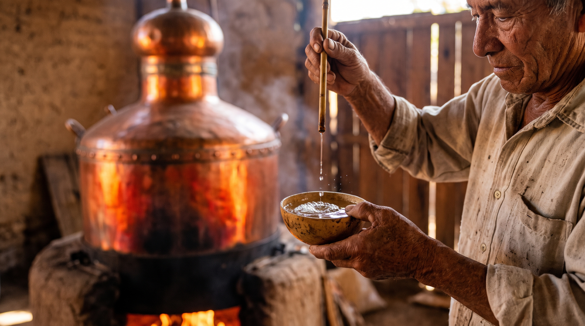
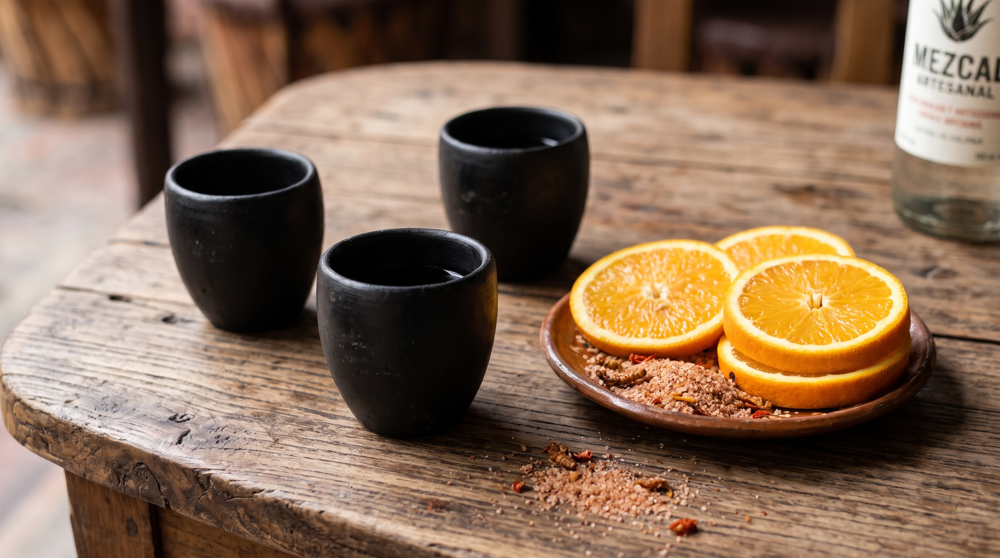

**Mezcal isn't manufactured; it's grown and passed down.** Forget crowded tour buses and souvenir-shop stops. We designed this private route for travelers who want to understand the soul of Oaxaca through its most sacred drink.

We take you straight to **Santiago Matatlán**, the "World Capital of Mezcal", to step inside the palenques (artisanal distilleries) where the process is still guided by the sun, the earth and time.

## What makes this experience different?

This isn't an off-the-shelf tour. You travel at your own pace in private transportation, which means you decide how long to spend talking with the master mezcal maker or tasting that *Tepeztate* and *Tobalá* blend.

- **Authentic access:** we visit small-batch, family-run palenques, not industrial factories.
- **Your pace:** no rush, no rigid itinerary.
- **Cultural focus:** learn to tell an espadín, a wild agave and a blend apart, and understand underground roasting, natural fermentation and double distillation in copper or clay.

## Suggested itinerary (100% flexible)

1. **Hotel pickup (10:00 AM):** a late start so you can enjoy your Oaxacan breakfast.
2. **The Tule Tree (optional):** a quick stop to admire the tree with the stoutest trunk in the world.
3. **First palenque (artisanal):** a full, step-by-step explanation of the production process, from harvesting the agave heart to crushing it with a horse-drawn stone tahona.
4. **Second palenque (ancestral):** see older distillation methods, often in clay pots, and enjoy a guided tasting of wild mezcals.
5. **Traditional lunch:** a stop at a local eatery to try classic dishes (tlayudas, mole or caldo de piedra) paired with your favorite mezcal.
6. **Back to downtown Oaxaca:** drop-off at your hotel around 5:00 PM.

## What's included

- Private, air-conditioned transportation.
- Bilingual local driver/guide (Spanish/English).
- Total flexibility with timing and stops.
- Cooler with bottled water on board.

*Note: premium tastings and meals are not included, so you're free to choose what and how much to enjoy.*

> **"Para todo mal, mezcal; para todo bien, también."** (For everything bad, mezcal; for everything good, too.)
> If you're looking for a deep experience that tastes of damp earth and smoke, this is your route. Request a quote and we'll tailor the trip to you.
