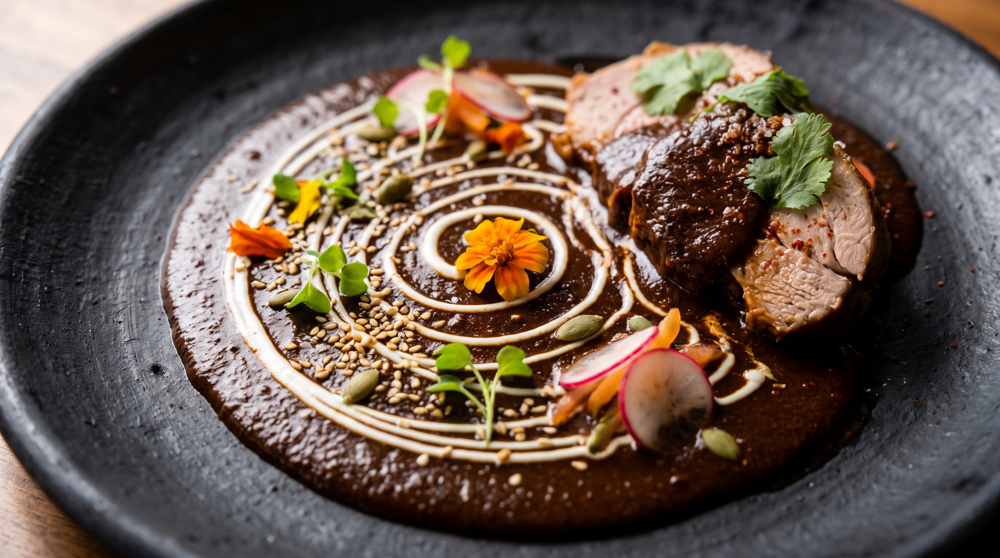
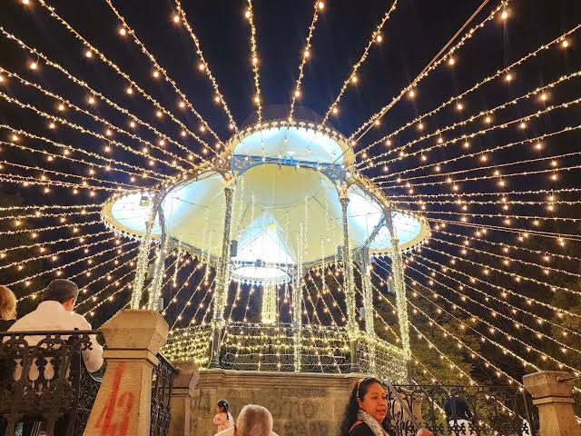

El atardecer en Oaxaca no solo se ve, se bebe y se saborea. Cuando el sol comienza a bajar, tiñendo las fachadas de cantera verde con tonos dorados, el único lugar donde debes estar es en las alturas.

El Centro Histórico concentra una oferta gastronómica de clase mundial. Hemos seleccionado las 7 terrazas imperdibles donde la vista panorámica compite directamente con la calidad de los platillos.

## 1. Pitiona: Gastronomía de Autor y Vistas Únicas

Dirigido por el Chef José Manuel Baños, Pitiona es una parada obligada para los amantes de la alta cocina. Su terraza ofrece una vista frontal espectacular de las cúpulas de Santo Domingo.

- **Imperdible:** La sopa de fideos con esferas de quesillo y sus cócteles experimentales.
- **Vibe:** Sofisticado, ideal para cenas románticas.

## 2. Casa Oaxaca El Restaurante

Un clásico que puso a Oaxaca en el mapa gastronómico internacional. El Chef Alejandro Ruiz combina la tradición de los pueblos con técnicas contemporáneas. Su terraza es íntima y altamente demandada.

- **Imperdible:** El mole negro servido con pechuga de guajolote y la salsa hecha en tu mesa.
- **Vibe:** Elegancia tradicional, perfecto para impresionar.

## 3. Tierra del Sol

Para quienes buscan sabores auténticos de la región Mixteca con una vista privilegiada del Jardín Etnobotánico y el Centro Histórico. La Chef Olga Cabrera rescata recetas ancestrales con una presentación impecable.

- **Imperdible:** El mole de caderas (en temporada) y su panadería artesanal.
- **Vibe:** Auténtico, familiar y muy relajado.

## 4. Los Amantes

Famoso por su impecable diseño interior y su ambiente vibrante. La terraza de Los Amantes es el "place to be" si buscas la mejor mixología a base de mezcal mientras el cielo oaxaqueño cambia de color.

- **Imperdible:** Su menú de tapas oaxaqueñas y cualquier cóctel de la casa.
- **Vibe:** Cosmopolita, excelente música, ideal para ir con amigos.

## 5. Mezquite Gastropub

Ubicado a escasos pasos de Santo Domingo, Mezquite ofrece un ambiente más relajado, combinando ingredientes locales con un toque de parrilla y comida reconfortante.

- **Imperdible:** Sus cortes de carne y tlayudas gourmet maridadas con cerveza artesanal local.
- **Vibe:** Casual, excelente para ir a tomar algo antes de la fiesta.

## 6. Gozobi

Una de las terrazas más grandes y animadas del centro. Es perfecta si viajas en grupo, ya que cuenta con un menú amplio que va desde opciones oaxaqueñas hasta cocina internacional, además de música en vivo varios días de la semana.

- **Imperdible:** Su carta de mezcales silvestres.
- **Vibe:** Festivo, concurrido y energético.

## 7. Praga

Ubicado estratégicamente frente a la plaza de Santo Domingo. Es una opción fantástica para disfrutar de la arquitectura virreinal desde primera fila sin tener que gastar en un menú de alta cocina.

- **Imperdible:** Una cerveza fría o un mezcal espadín al atardecer observando el movimiento de la plaza.
- **Vibe:** Desenfadado, turístico y muy fotogénico.

> **¿No encuentras mesa disponible?**
> Las mejores terrazas en Oaxaca requieren reservación con semanas de anticipación. **Solicita asistencia a nuestro servicio de Concierge**: te ayudamos a conseguir la mejor mesa y organizamos tus traslados privados para que solo te preocupes por disfrutar.
